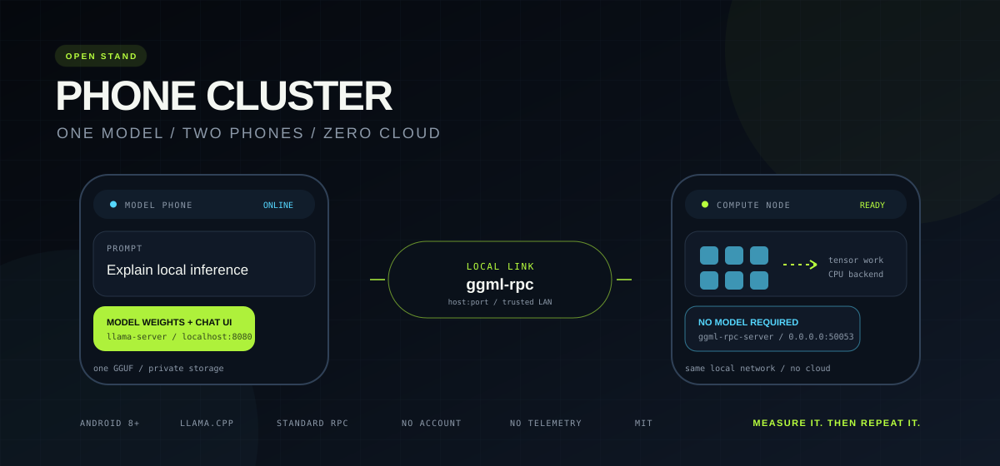
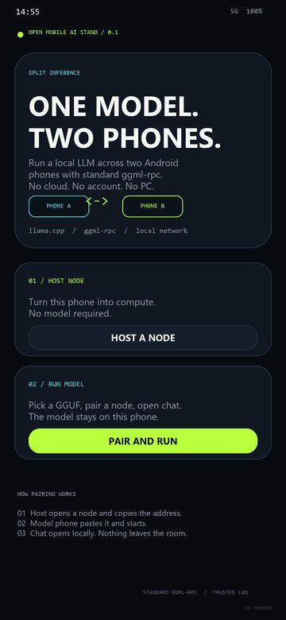
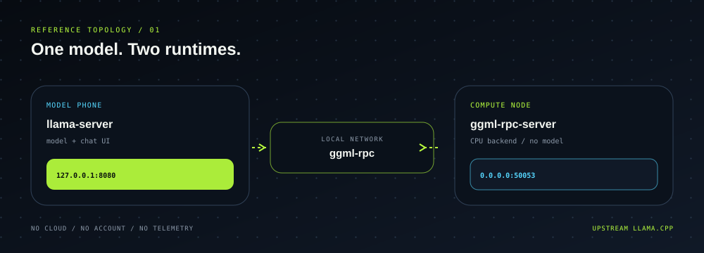

<div align="center">
  
</div>

<h1 align="center">PHONE CLUSTER</h1>

<p align="center">
  <strong>Two phones. One model. Zero cloud.</strong><br>
  A tiny open stand for split LLM inference across Android phones using upstream <code>llama.cpp</code> and standard <code>ggml-rpc</code>.
</p>

<p align="center">
  <a href="https://github.com/ggarembroo/phone-cluster/stargazers"></a>
  
  
  
  
</p>

<p align="center">
  <a href="#quick-start">Quick start</a> ·
  <a href="#how-it-works">How it works</a> ·
  <a href="#build">Build</a> ·
  <a href="#security">Security</a> ·
  <a href="#roadmap">Roadmap</a>
</p>

> **This is a public test stand, not the Kruko AI app.** It is deliberately
> bare-bones: upstream inference, a plain pair address, and honest measurements.
> No hidden-state transport, no draft acceleration, no custom scheduler, no
> secret sauce.

<p align="center">
  
</p>

<p align="center">
  <sub>UI preview. A real two-phone run and benchmark table ship with the first tagged release.</sub>
</p>

## Why this exists

Running a useful model on one phone is easy. Running a model that does not fit
on one phone is the interesting part.

Phone Cluster is the smallest reproducible answer: one Android phone keeps the
model and the chat UI, the other exposes compute over the local network, and
`llama.cpp` moves tensor work between them through standard `ggml-rpc`.

It is a **reference stand**, not a benchmark leaderboard entry. The point is to
make the moving parts visible, measurable, and replaceable.

## What you get

| | |
|---|---|
| **Pair in seconds** | Host shows a local address. Model phone pastes it. No account, no QR service, no cloud broker. |
| **Local chat** | The model exposes a local `llama-server` endpoint and opens its chat UI in a native WebView. |
| **Bring your own GGUF** | Pick any compatible model from Android's document picker. Files stay in private app storage. |
| **Measure it** | One tap sends a deterministic completion request and reports decoded tokens per second. |
| **Small surface** | Two native binaries, one activity, no analytics, no telemetry, no network permission beyond the local socket. |

## How it works

<p align="center">
  
</p>

```text
┌──────────────────────────────┐          ┌──────────────────────────────┐
│  MODEL PHONE                 │          │  COMPUTE NODE                │
│  llama-server                │  local   │  ggml-rpc-server             │
│  model weights + chat UI     │◄────────►│  CPU backend                 │
│  127.0.0.1:8080              │  network │  0.0.0.0:50053               │
└──────────────────────────────┘          └──────────────────────────────┘
             ▲
             │  paste host:port
             │
       pair address
```

The model phone starts `llama-server` with `--rpc <node>:50053`. The node does
not need the model file. Both sides use the same vanilla build of `llama.cpp`.

## Quick start

### 1. Install

Download the latest APK from [Releases](https://github.com/ggarembroo/phone-cluster/releases).

```text
Package:  ai.phonecluster.stand
Min:      Android 8.0 (API 26)
ABI:      arm64-v8a
```

Android may warn about installing an app from outside the Play Store. This is a
developer stand. Use a trusted build.

### 2. Host a node

On the phone that will contribute compute:

1. Open **Phone Cluster**.
2. Tap **Host a node**.
3. Connect both phones to the same Wi-Fi, or use USB tethering.
4. Tap **Start node** and copy the displayed `host:port`.

The node is reachable only on the local network. Do not expose port `50053` to
the internet.

### 3. Run the model

On the phone that will keep the model:

1. Tap **Run a model**.
2. Paste the host address.
3. Choose a `.gguf` file.
4. Tap **Start session**.

The app copies the model into private storage, starts `llama-server`, waits for
the local endpoint, and opens the chat UI.

### 4. Measure

Tap **Bench** in the chat header. The stand sends a fixed completion request and
shows decoded tokens per second in the header.

## Models

Phone Cluster does not ship model weights. The node does not need weights; only
the model phone does.

Good starting points:

| Model | Size | Why |
|---|---:|---|
| Qwen2.5 0.5B Instruct Q4_K_M | ~400 MB | Fast sanity check, low memory |
| Qwen2.5 1.5B Instruct Q4_K_M | ~1 GB | Good quality / memory balance |
| Llama 3.2 1B Instruct Q4_K_M | ~800 MB | Small dense model with wide tooling support |
| A larger GGUF | 4 GB+ | The actual reason to split across phones |

Use a quantized GGUF that fits the combined memory of both phones with headroom
for the KV cache. `-ngl 99` is the default in this stand, so the node carries the
offloaded layers.

## Build

Requirements:

- JDK 17
- Android SDK 36
- Android NDK 27
- CMake and Ninja
- A Linux/macOS shell, or adapt the CMake command for Windows

### Native binaries

Build upstream `llama.cpp` with RPC enabled and static linking:

```bash
export ANDROID_NDK="$HOME/Android/Sdk/ndk/27.1.12297006"
export TOOLCHAIN="$ANDROID_NDK/build/cmake/android.toolchain.cmake"

cmake -S llama.cpp -B build/android-arm64 -G Ninja \
  -DCMAKE_TOOLCHAIN_FILE="$TOOLCHAIN" \
  -DANDROID_ABI=arm64-v8a \
  -DANDROID_PLATFORM=android-28 \
  -DCMAKE_BUILD_TYPE=Release \
  -DBUILD_SHARED_LIBS=OFF \
  -DGGML_RPC=ON \
  -DLLAMA_BUILD_SERVER=ON \
  -DLLAMA_BUILD_TESTS=OFF

cmake --build build/android-arm64 --target llama-server ggml-rpc-server -j

mkdir -p app/src/main/jniLibs/arm64-v8a
cp build/android-arm64/bin/llama-server app/src/main/jniLibs/arm64-v8a/libpc_llama_server.so
cp build/android-arm64/bin/ggml-rpc-server app/src/main/jniLibs/arm64-v8a/libpc_ggml_rpc_server.so
```

Then build the APK:

```bash
export JAVA_HOME=/path/to/jdk-17
./gradlew :app:assembleDebug
```

The APK lands at `app/build/outputs/apk/debug/app-debug.apk`.

## Benchmarks

Real device numbers only. See [docs/BENCHMARKS.md](docs/BENCHMARKS.md) for the
measurement protocol and the latest run.

The short version: two phones are not automatically faster than one. This stand
is for models that need more memory than a single device can provide. For a
small model that fits on one phone, run it on one phone.

## Security

This is a trusted-LAN stand.

- `ggml-rpc-server` listens on `0.0.0.0:50053` with no authentication.
- `llama-server` binds only to `127.0.0.1:8080` on the model phone.
- There is no cloud account, telemetry, or remote model endpoint.
- Anyone who can reach port `50053` on the node can use its compute.

Use a private Wi-Fi network, a hotspot with a strong password, or USB tethering.
Do not port-forward the node.

See [docs/SECURITY.md](docs/SECURITY.md) for the full threat model.

## What is deliberately missing

Phone Cluster is intentionally not the production engine.

- no hidden-state or logits-free transport
- no speculative decoding or draft model
- no automatic layer scheduler
- no model download service
- no authentication
- no fault tolerance
- no 3+ node topology
- no benchmark claims without device runs

Those belong in a product, not in a readable reference stand.

## Roadmap

- [ ] QR pairing and scanner
- [ ] USB tether auto-discovery
- [ ] model presets with memory estimates
- [ ] exportable benchmark JSON
- [ ] three-node topology
- [ ] optional pairing token
- [ ] x86_64 emulator build
- [ ] short demo GIF in every release

## Contributing

The most useful contributions are:

1. A real measurement on a phone pair, with model, quant, Android version, and
   transport.
2. A reproducible failure, especially around RPC connectivity.
3. A smaller, clearer implementation of the same behavior.

Open an issue before a large PR. Keep the scope narrow. No model files, keys, or
generated APKs in pull requests.

## Credits

- [llama.cpp](https://github.com/ggml-org/llama.cpp) and
  [ggml](https://github.com/ggml-org/ggml) for the inference core and RPC backend.
- The Android platform for a surprisingly capable local runtime.
- Everyone who measures instead of guessing.

## License

MIT. See [LICENSE](LICENSE).

If this stand saves you a weekend, leave a star. It helps other people find it.
